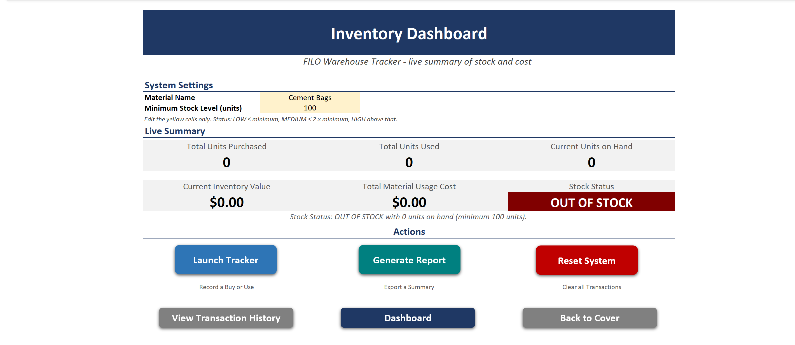

# FILO Inventory Cost Calculator (Excel VBA)

An Excel/VBA application for a small warehouse that buys and uses **one material** in batches at different unit costs. It records every purchase and usage, costs each usage by the batches actually consumed, and keeps a live dashboard of stock, value and status.

## What it does

- **Buy / Use transactions** through a UserForm, each with an auto-generated sequential ID (starting at 1001).
- **FILO costing**: every Use takes stock from the newest Buy batch first, then moves to older batches. Usage cost is the sum of (quantity taken x that batch's unit cost).
- **Live dashboard**: total purchased, total used, units on hand, inventory value, usage cost, and a colour-coded stock status.
- **Stock status** from a user-set minimum level: OUT OF STOCK (0), LOW (up to the minimum), MEDIUM (up to 2x the minimum), HIGH (above that).
- **Transaction history** sheet that greys out Buy batches once they are fully used.
- **Report generation**: a formatted summary opens in a new workbook, with an optional save prompt that suggests a timestamped file name.
- **Reset** that clears all transactions and restores the default settings, after a confirmation.

## Screenshots

| Dashboard | Transaction User Form |
|---|---|
|  |  |

| Transaction history | Generated report |
|---|---|
|  |  |

## How the FILO allocation works

Say there are three Buy batches still in stock: 10 units at $1, 20 at $2 and 30 at $3 (oldest to newest). A Use of 55 units is costed like this:

1. Take 30 units from the newest batch: 30 x $3 = $90 (that batch is now empty and greyed out).
2. Take 20 units from the next batch: 20 x $2 = $40 (also empty).
3. Take the last 5 units from the oldest batch: 5 x $1 = $5.

Usage cost = $135, and 5 units remain in the oldest batch.

In the code, the batches with stock are read into arrays (row, remaining quantity, unit cost) starting from the newest. A loop walks the arrays and consumes quantity until the order is filled. All results are calculated **in memory first**, and only then written to the sheet, so a failure cannot leave half-written data.

## Design decisions

- **Template-based report.** The report layout is a hidden template sheet. The macro copies it into a new workbook and fills in the values, so the formatting is designed by hand rather than coded.
- **History is the single source of truth.** The dashboard is always recalculated from the transaction history rather than adjusted incrementally.
- **Strict validation.** Quantities must be whole numbers from 1 to 1,000,000. Unit costs must be from 0.01 to 1,000,000. Minimum stock is a whole number from 0 to 1,000,000. Material names are 1 to 50 characters. A Use cannot exceed the stock on hand. Invalid input shows a red field and a clear message instead of a crash.
- **Error handling everywhere.** Each entry point has an `On Error GoTo` handler with a user-friendly message.
- **Small modules.** Validation, FILO calculation, dashboard updates, formatting, navigation and reporting are separate procedures. Shared constants (colours, column letters, limits) live in one module.

## Testing

Checked by hand, including a "bad user" pass:

- Status boundaries: exactly the minimum, minimum + 1, exactly 2x the minimum, 2x + 1, and zero.
- FILO cases: a Use inside one batch, across several batches, exactly one batch, and all remaining stock.
- Bad input: blank, zero, negative, decimal, text, percentages, very large numbers, and pasted text.
- Tampering: editing dashboard cells, deleting history rows, and breaking the settings while the form is open.
- Reset in different states, and report generation on an empty system.

## Project layout

- `src/` exported VBA code (standard modules, UserForm, sheet modules and ThisWorkbook)
- `workbook/` the macro-enabled workbook (`.xlsm`)
- `demo/` screenshots used in this README

## How to run

1. Open the workbook in Excel for Windows and click **Enable Editing** and **Enable Content** so macros can run.
2. Click **Start Application** on the cover page.
3. Use **Launch Tracker** to add transactions, **Generate Report** for the summary, and **Reset System** to start again.

## Tech

Excel VBA: UserForms, worksheet events, arrays, named ranges, and error handling.
